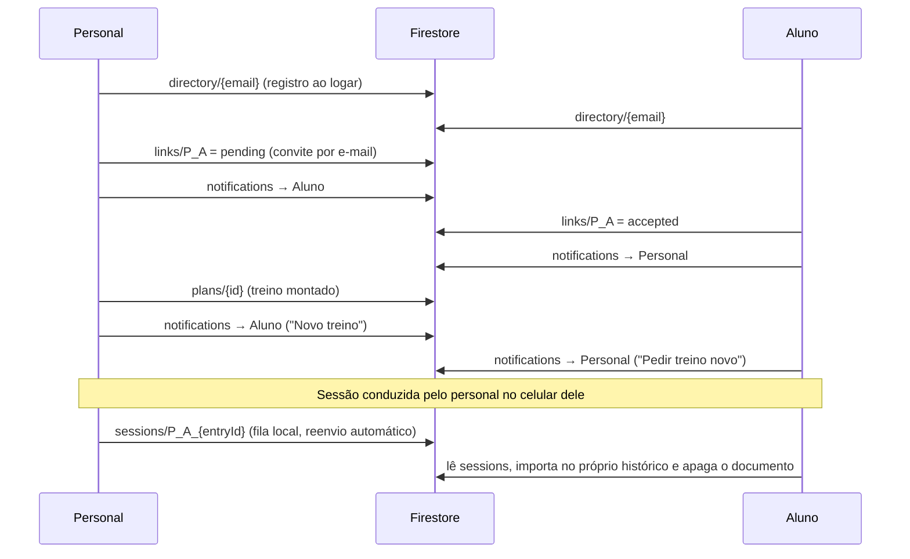

# 🏋️ Will Gym PRO

App web de registro e acompanhamento de treinos de musculação e aeróbicos, com modo **Personal Trainer** (alunos, avaliações, treinos personalizados, recados e notificações).

- **Demo:** <https://martinswillians.github.io/WgymPro/>
- **Stack:** um único arquivo HTML/CSS/JavaScript (sem build) + Firebase Authentication e Cloud Firestore
- **Idioma:** português (BR)

---

## Sumário

1. [Funcionalidades](#funcionalidades)
2. [Arquitetura](#arquitetura)
3. [Estrutura do repositório](#estrutura-do-repositório)
4. [Executar localmente](#executar-localmente)
5. [Configurar o Firebase](#configurar-o-firebase)
6. [Publicar no GitHub Pages](#publicar-no-github-pages)
7. [Fluxo Personal ↔ Aluno](#fluxo-personal--aluno)
8. [Modelo de dados](#modelo-de-dados)
9. [Segurança e privacidade](#segurança-e-privacidade)
10. [Limitações conhecidas](#limitações-conhecidas)
11. [Histórico de versões](#histórico-de-versões)
12. [Licença](#licença)

---

## Funcionalidades

### Treino
- **Modos de treino:** Solo, Dupla, Grupo, Livre e Sugerido; vários atletas por conta.
- **Grupos musculares e exercícios** com grupos e exercícios personalizados; exercícios **aeróbicos** (tempo, velocidade, inclinação).
- **Registro de séries** (séries, repetições, carga, descanso) com sugestão de progressão e alerta de estagnação.
- **Dados do último treino:** séries, reps e kg vêm preenchidos do último treino do atleta no exercício, com a referência "📋 Último treino (dd/mm)".
- **Monitoramento de tempo** (escolha na tela Treino, lembrada entre usos):
  - *Padrão:* registra a série e conta o descanso (contagem regressiva).
  - *Cronometrado:* ▶ Iniciar série → 😮‍💨 Descanso → ✓ Finalizar descanso / ▶ Próxima série. Cada ciclo registra **uma série** com o tempo medido; o campo "Séries" é a meta ("Série 2 de 4"). Funciona também em aeróbicos.
  - **Alerta de descanso:** ao atingir o descanso escolhido, o painel pisca e o aparelho vibra por 5 s (bipes no iOS, que não tem Vibration API); o cronômetro continua contando.
- **Resumo do treino** com duração total, tempo exercitando e tempo de descanso, volume, séries, melhor 1RM e PRs.
- **Cancelar exercício** (✕ no título e botão no rodapé) e **Encerrar treino** (botão do topo e do rodapé da tela Treino).
- **Retomada de treino:** ao voltar ao app, "Continuar treino" restaura a tela e o exercício onde parou.
- **Fotos do treino** (até 4 por sessão, guardadas só no aparelho).

### Histórico, dashboard e compartilhamento
- Histórico por dia e por treino, com edição de hora/séries e exclusão.
- Dashboard: meta semanal, treinos e volume da semana, tempo médio, exercício mais treinado, recordes pessoais (1RM estimado); filtro por atleta com **busca por nome** quando há muitos perfis.
- **Compartilhar** resumo e **card em imagem** (com fotos e tempos). Com fotos, E-mail/WhatsApp/Mais abrem a folha de compartilhamento do sistema com **card + todas as fotos anexadas** (Web Share API).
- Quando há **mais de um treino no mesmo dia**, o compartilhamento do dia permite escolher qual treino enviar.
- **Compartilhar o app por QR code** (Config → Compartilhar o app); o gerador de QR é embutido e funciona offline.
- Planos, templates rápidos, backup (exportar/importar JSON), tema escuro, meta semanal.

### Modo Personal Trainer
- Cadastro como **Aluno** ou **Personal Trainer** (e alternância em Config → Modo Personal Trainer).
- **Aba Alunos:** semáforo por aluno (No ritmo, Queda de volume, Atenção, Sumido, Sem treinos), frequência vs. meta, tendência de volume, PRs, filtros e busca.
- **Detalhe do aluno:** frequência de 8 semanas, progressão de 1RM por exercício, treinos recentes, **avaliação física** (peso, % gordura, cintura, com variação) e **anotações privadas**.
- **Vínculo por e-mail** com solicitação → aceite, nos dois sentidos (personal convida aluno ou aluno convida personal).
- **Montador de treino** (vários dias, exercício, séries, reps, carga, descanso, recado). O aluno vê "🏅 Treino montado pelo personal *Nome*" e inicia com as metas pré-preenchidas.
- **Treino de hoje:** o cartão sugere o próximo dia do treino (A → B → C…), mostra os exercícios, "Continuar treino (1/3)" e segue os exercícios montados.
- **Alunos vinculados no Dashboard e na tela Treino do personal:** ver a evolução (somente leitura) e conduzir o treino montado pelo celular do personal. A sessão fica registrada no nome do aluno e é **entregue ao histórico do próprio aluno** (ver [fluxo](#fluxo-personal--aluno)).
- **Recados** com o personal/aluno agora vivem na aba **Chat** (abaixo); os botões 💬 do app abrem a conversa certa.
- **Notificações 🔔** (sino no cabeçalho): convites, aceite/recusa, treino novo/atualizado, recados, **pedido de treino novo/atualização** (aluno → personal), aluno concluiu treino, treino registrado pelo personal.

### Chat (aba 💬)
- **Conversas em tempo real** (escuta do Firestore, sem recarregar): lista com última mensagem, hora e **contador de não lidas**; busca por conversa/contato.
- **Quem pode conversar:** aluno ↔ personal (vínculo aceito), **aluno ↔ aluno** e qualquer pessoa que aceitou ser **contato** (convite por e-mail, com aceite).
- **Grupos:** criados a partir dos contatos; quem é convidado vê o convite e **entra ao aceitar** (ou recusa). Qualquer membro pode convidar mais contatos ou sair do grupo.
- **Conversa:** separador por dia, divisor **"Novas mensagens"**, pílula "⬇ N novas mensagens" quando você está lendo mensagens antigas, **✓ enviado / ✓✓ visto**, apagar a própria mensagem, "carregar mensagens anteriores" (100 por vez), Enter envia e Shift+Enter quebra linha.
- **Avisos:** aviso na tela (e vibração) quando chega mensagem em outra conversa, selo no menu "Chat" e, com permissão, aviso do sistema com o app em segundo plano.
- As mensagens do chat antigo entre personal e aluno continuam aparecendo no início da conversa.

---

## Arquitetura

```
┌──────────────────────────── navegador ────────────────────────────┐
│  index.html  (HTML + CSS + JS, tudo em um arquivo)                │
│   ├─ estado em memória (state, users, history…)                   │
│   ├─ localStorage  ← fonte de dados local (funciona sem conta)    │
│   └─ ponte window.FB (módulo ES) → Firebase Auth + Firestore      │
└───────────────────────────────┬───────────────────────────────────┘
                                │ sync por chave + coleções compartilhadas
                  ┌─────────────▼─────────────┐
                  │  Firebase (projeto seu)   │
                  │  • Authentication         │  e-mail e senha
                  │  • Cloud Firestore        │  dados + regras de segurança
                  └───────────────────────────┘
```

- **Sem build e sem dependências locais.** O Firebase é carregado por CDN (módulos ES).
- **Offline-first nos dados:** tudo é gravado no `localStorage`; com conta, as chaves são sincronizadas com o Firestore.
- **Instalável, mas sem service worker:** há `manifest` embutido (adicionar à tela inicial), porém o app **remove** service workers antigos e não registra nenhum. A página precisa de rede para carregar; depois de carregada, o registro de treinos funciona sem conexão e sincroniza quando voltar.
- **Visitante:** é possível usar sem conta (dados só no aparelho). Recursos de Personal, vínculos, notificações e recados exigem conta.

---

## Estrutura do repositório

```
.
├── index.html        # o app (copie a versão mais recente, ex.: wgym_v52_sessions_to_student.html)
├── firestore.rules   # regras de segurança do Firestore
└── README.md
```

---

## Executar localmente

Qualquer servidor estático serve:

```bash
python3 -m http.server 8000
# abra http://localhost:8000
```

> Para login e sincronização, adicione `localhost` em **Authentication → Configurações → Domínios autorizados** no Firebase.

---

## Configurar o Firebase

1. Crie um projeto em <https://console.firebase.google.com> e adicione um **app Web**.
2. **Authentication → Método de login:** ative **E-mail/senha**.
3. **Firestore Database:** crie o banco (modo produção).
4. **Regras:** abra *Firestore Database → Regras*, apague o conteúdo e cole o arquivo [`firestore.rules`](firestore.rules); clique em **Publicar**.
   - ⚠️ O **Realtime Database** não é usado. Não cole estas regras lá (a sintaxe é outra).
5. No `index.html`, substitua o objeto `firebaseConfig` (procure por `const firebaseConfig`) pelos dados do seu app Web.
6. **Authentication → Configurações → Domínios autorizados:** adicione o domínio de publicação (ex.: `seu-usuario.github.io`).

Sempre que o `firestore.rules` mudar numa versão nova do app, publique-o novamente.

---

## Publicar no GitHub Pages

1. Coloque o app na raiz do repositório com o nome `index.html`.
2. **Settings → Pages →** *Deploy from a branch* → branch `main`, pasta `/ (root)`.
3. Após a publicação, recarregue com `Ctrl+F5` (ou feche e reabra o app instalado) para pegar a versão nova.
4. Confira a versão em **Config → Conexões personal ↔ aluno** (aparece "app vNN").

---

## Fluxo Personal ↔ Aluno e Chat



- O aluno só passa a ser visível ao personal depois de **aceitar** o vínculo; qualquer lado pode **remover** depois.
- Com vínculo aceito, o personal pode **ler apenas o histórico de treinos** do aluno (`users/{uid}/data/wgym_history`).
- Sessões registradas no celular do personal usam um **atleta "espelho" local** (`lk_<uid>`, escondido das listas). Cada exercício concluído entra numa **fila local** (`wgym_session_outbox`) e é enviado quando houver conexão; o app do aluno importa para o histórico dele (como o atleta principal da conta), sem duplicar.
- Os dados do aluno vinculado aparecem no Dashboard do personal em modo **somente leitura**.
- **Chat:** a primeira mensagem de uma conversa direta cria o documento `chats/d_…`; cada envio grava a mensagem, atualiza `lastMessage`/`unread` e o recibo `reads` de quem enviou. Quem abre a conversa zera o próprio `unread` e grava o próprio `reads`. Contato entre alunos: `contacts/…` (pendente → aceito pelo destinatário) e só então a conversa pode ser criada.

---

## Modelo de dados

### Firestore

| Caminho | Conteúdo | Quem acessa |
|---|---|---|
| `users/{uid}/data/{chave}` | dados sincronizados do app (ver chaves abaixo) | só o dono; o personal vinculado lê apenas `wgym_history` |
| `directory/{email}` | `uid`, `name`, `email`, `avatar`, `personal` — para encontrar alguém pelo e-mail exato | leitura: logado; escrita: o próprio |
| `links/{personalUid_studentUid}` | `status` (`pending`/`accepted`), `requestedBy`, nomes e e-mails | as duas partes |
| `links/{id}/messages/{id}` | recados do chat antigo (somente leitura; aparecem no início da conversa) | as duas partes |
| `contacts/{uidA_uidB}` | contato entre duas pessoas (`uids`, `names`, `emails`, `status`, `requestedBy`); id com os uids em ordem alfabética | as duas partes; só o destinatário aceita |
| `chats/{d_uidA_uidB \| g_id}` | conversa (`type` direct/group, `members`, `pending` convidados, `memberNames`, `lastMessage`, `unread`, `reads`) | só membros (convidados leem o próprio convite) |
| `chats/{id}/messages/{id}` | mensagens (`from`, `name`, `text` até 2000 caracteres, `ts`) | membros leem e enviam; só o autor apaga |
| `plans/{id}` | treino montado (dias, exercícios, séries, reps, carga, descanso) | personal escreve; as duas partes leem |
| `notifications/{id}` | `toUid`, `fromUid`, `type`, `title`, `body`, `ts`, `read` | cria quem tem vínculo; lê, marca como lida e apaga só o destinatário |
| `sessions/{personalUid_studentUid_entryId}` | exercício registrado pelo personal para o aluno | personal cria (vínculo aceito); aluno importa e apaga |

Chaves sincronizadas em `users/{uid}/data`: `wgym_users`, `wgym_history`, `wgym_settings`, `wgym_plans`, `wgym_templates`, `wgym_custom_ex`, `wgym_custom_groups`, `wgym_favs`, `wgym_rest_defaults`, `wgym_notif`, `wgym_notif_time`, `wgym_notif_days`, `wgym_hidden_ex`, `wgym_ex_aliases`, `wgym_trainer_data` (avaliações, anotações e treinos dos atletas locais do personal), `wgym_personal_mode`.

### Somente no aparelho (`localStorage`)
`wgym_workout_photos` (fotos, com limite de espaço), `wgym_active_session` (retomada de treino), `wgym_time_style`, `wgym_last_mode`, `wgym_session_outbox`, `wgym_notif_seen`, `wgym_chat_read_*`, `wgym_req_*` (limite de pedidos ao personal).

### Entrada do histórico (resumo)
`id`, `date`, `exercise`, `group`, `mode`, `userId`, `series[]` (`reps`, `load`, `rest`, `dur`, `restDur`, `tid`…), `trainStart`, `trainDur`, `isAerobic`, `planId`, `planDay`, `planDayName`, `syncId`, `byPersonal`.

---

## Segurança e privacidade

- A **chave de API do Firebase Web não é segredo**; quem protege os dados são as **regras do Firestore** e os **domínios autorizados**. Publique sempre o `firestore.rules`.
- O diretório permite encontrar uma conta **somente pelo e-mail exato** (não há listagem).
- Quem pediu o vínculo **não consegue se auto-aceitar**; só o destinatário aceita.
- O personal lê **somente** `wgym_history` do aluno, e só com vínculo aceito. Avaliações e anotações do personal ficam na conta dele e não são visíveis ao aluno.
- Fotos de treino **não** vão para a nuvem.
- **Chat:** só membros leem e escrevem; conversa direta só é criada entre pessoas com contato/vínculo **aceito**; o recibo de leitura (`reads`) só pode ser alterado pela própria pessoa; grupos funcionam por **convite com aceite**; as consultas do chat não exigem índices compostos.
- Recomendações: ative o **App Check** no Firebase e revise periodicamente os acessos na aba *Uso*.

---

## Limitações conhecidas

- **Sem push com o app fechado.** As notificações são verificadas a cada ~30 s com o app aberto e ao voltar para ele. Push de verdade exigiria Firebase Cloud Messaging + Cloud Functions (plano Blaze).
- Os avisos do sistema (`Notification API`) funcionam com o app aberto ou em segundo plano recente, e dependem da permissão do navegador. No iOS não há vibração; o app usa bipes.
- Um exercício **editado ou apagado** no celular do personal depois de enviado ao aluno **não** é atualizado no histórico do aluno.
- Se o aluno não tiver conta aberta há muito tempo, as sessões ficam aguardando na coleção `sessions` até ele abrir o app.
- Uma sessão conduzida pelo personal é gravada no histórico do aluno como o **atleta principal da conta dele** (o perfil com o mesmo nome da conta, ou o primeiro).
- **Grupos:** as regras não conseguem verificar, em lote, se quem convida tem contato com cada convidado. O app só oferece contatos, mas um cliente modificado poderia convidar qualquer pessoa — ela vê o convite e pode recusar. Mensagens são só texto (sem imagens/arquivos).
- O chat usa escuta em tempo real: com o app aberto o consumo de leituras do Firestore é baixo (só o que muda), mas contas com muitas conversas ativas podem se aproximar da cota gratuita do plano Spark.
- Não há suíte de testes automatizados no repositório.

---

## Histórico de versões

| Versão | Principais mudanças |
|---|---|
| v36 | Correção de "Concluir exercício" (histórico não some mais; proteção contra falta de espaço no armazenamento) e da retomada do treino na tela correta |
| v37 | Botão "Encerrar treino" também no rodapé; compartilhar com card + todas as fotos (Web Share); card sem falha quando há PR |
| v38–v42 | Monitoramento de tempo cronometrado, dados do último treino, cancelar exercício, alerta de descanso, cronômetro em aeróbicos, tempos no resumo e nos cards, escolha do treino do dia no compartilhamento |
| v43–v44 | QR code para compartilhar o app (Perfil e Config) |
| v45–v47 | Modo Personal Trainer (painel de alunos, avaliação, montador de treino), vínculo por e-mail, cadastro como Personal, correção do envio de convite |
| v48–v49 | Notificações (sino) e recados com contadores de não lidas |
| v50–v51 | Alunos vinculados no Dashboard e na tela Treino; "Treino de hoje" com início e continuação dos exercícios montados |
| v52 | Sessões registradas pelo personal são entregues ao histórico do aluno (novas regras `sessions`) |
| v53 | **Aba Chat:** conversas em tempo real (aluno↔personal, aluno↔aluno, grupos com convite), contatos por e-mail, não lidas, ✓✓ visto, apagar mensagem; novas regras `chats` e `contacts` |

---

## Licença

Defina a licença do projeto (por exemplo, MIT) e adicione um arquivo `LICENSE`. Enquanto não houver licença, todos os direitos permanecem reservados ao autor.
